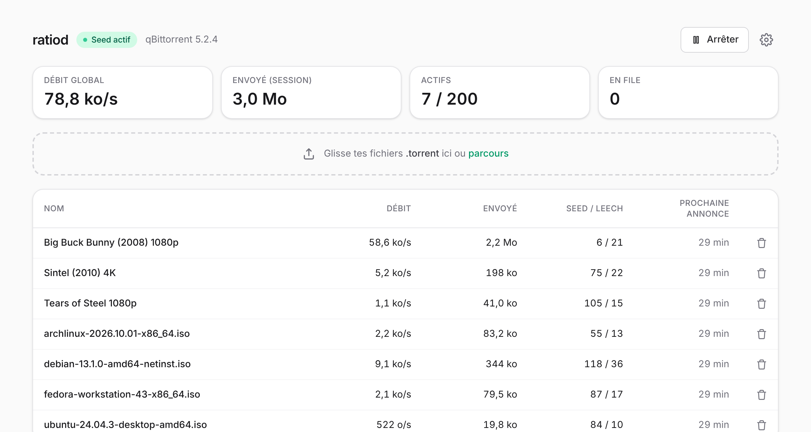
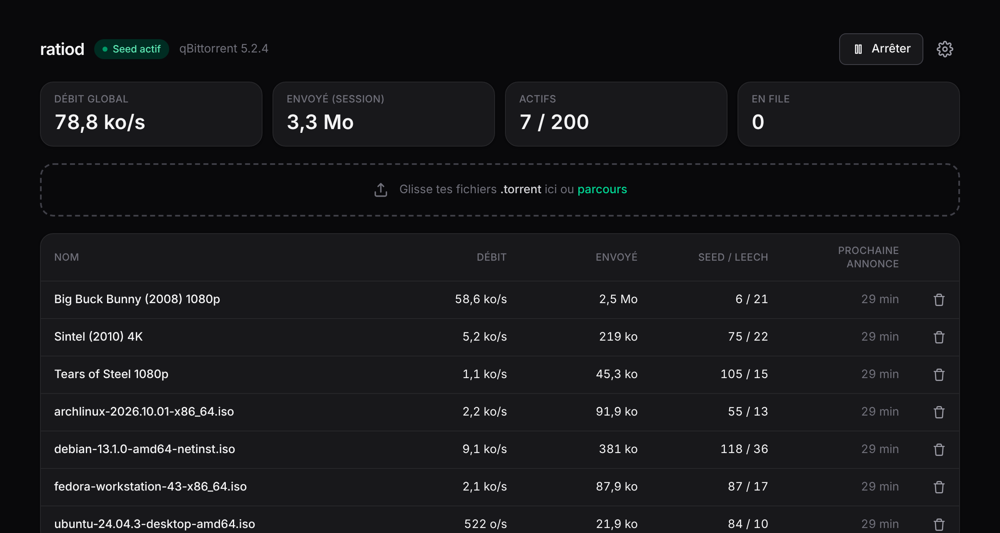
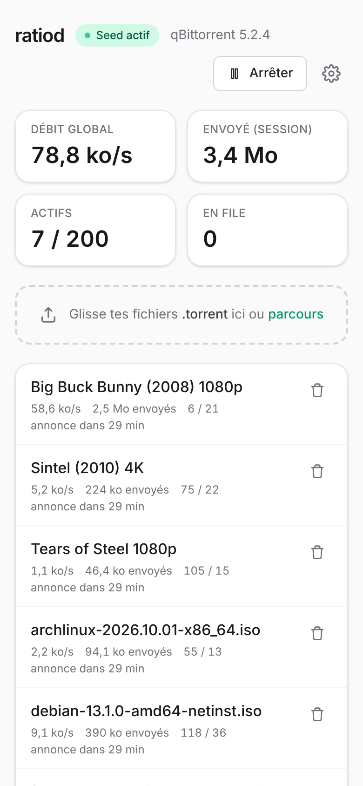
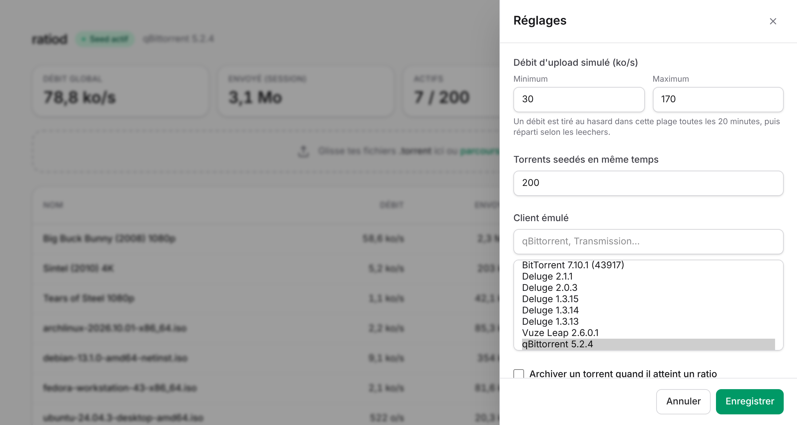

# ratiod

Réécriture en Rust de [Joal](https://github.com/anthonyraymond/joal) : un faux client BitTorrent qui annonce
aux trackers un upload simulé pour tes fichiers `.torrent`, sans rien transférer. Un seul binaire de quelques Mo
avec son interface web, disponible pour **Windows**, **Linux** et **Docker**. Pas d'authentification : les
paquets Windows et Linux n'écoutent que sur `127.0.0.1`.

> **Avertissement** (repris de Joal) : ratiod n'est pas conçu pour aider à télécharger du contenu illégal.
> Respecte la loi de ton pays et les règles de tes trackers.

## Aperçu



<table>
  <tr>
    <td width="62%"></td>
    <td></td>
  </tr>
  <tr>
    <td align="center"><sub>Thème sombre (suit le réglage du système)</sub></td>
    <td align="center"><sub>Sur mobile, la liste passe en cartes</sub></td>
  </tr>
</table>


<p align="center"><sub>Réglages : débit simulé, nombre de torrents seedés, client émulé (95 profils), ratio cible</sub></p>

## Installation

Trois façons de lancer ratiod. Les deux paquets (Windows et Linux) n'écoutent que sur la machine elle-même :
l'interface est sur **http://127.0.0.1:5081** et n'est pas joignable depuis le réseau.

Les paquets sont sur la page [**Releases**](https://github.com/xavierl/ratiod/releases/latest) (le dépôt est
privé : il faut être connecté à GitHub pour les télécharger). `SHA256SUMS.txt` permet de vérifier les fichiers.

| Paquet | Système |
|---|---|
| `ratiod-<version>-windows-x86_64.zip` | Windows 10 / 11, 64 bits |
| `ratiod-<version>-linux-x86_64.tar.gz` | Linux 64 bits (PC, la plupart des NAS) |
| `ratiod-<version>-linux-aarch64.tar.gz` | Linux ARM 64 bits (Raspberry Pi 4/5, NAS ARM) |

### Windows

1. Télécharge et décompresse `ratiod-<version>-windows-x86_64.zip` où tu veux (par exemple `Documents\ratiod`).
2. Double-clique sur `ratiod.exe` : l'interface s'ouvre directement dans sa propre fenêtre, sans console ni
   navigateur. **Fermer la fenêtre la masque seulement** : ratiod continue de seeder, son icône reste dans la
   zone de notification (près de l'horloge ; clique sur `^` si elle est masquée). Un clic gauche sur l'icône
   rouvre la fenêtre ; le clic droit propose « Ouvrir ratiod » et « Quitter ». **« Quitter » arrête
   proprement ratiod** (annonces `stopped` aux trackers, 5 s au plus). Relancer `ratiod.exe` alors qu'il tourne
   déjà ramène simplement sa fenêtre au premier plan.
3. Windows 10/11 fournit normalement **Microsoft WebView2**, qui affiche la fenêtre. S'il manque, ratiod
   l'indique et donne le lien de téléchargement : https://go.microsoft.com/fwlink/p/?LinkId=2124703

Au premier lancement :
- **SmartScreen** (« Windows a protégé votre ordinateur ») : l'exécutable n'est pas signé. Clique sur
  « Informations complémentaires » puis « Exécuter quand même ».
- **Pare-feu Windows** : il demande d'autoriser ratiod sur le réseau. C'est le port pair annoncé aux trackers ;
  autorise au moins les réseaux privés. L'interface web, elle, reste limitée à `127.0.0.1`.

ratiod est **portable** : ses données sont dans le dossier `data` créé à côté de `ratiod.exe` (déplace le
dossier entier pour déplacer l'installation). Une installation v0.1.0 garde son dossier `%APPDATA%\ratiod`
tant que `data` n'existe pas à côté de l'exe ; si le dossier de l'exe n'est pas modifiable (par exemple
`Program Files`), `%APPDATA%\ratiod` est utilisé. Les logs sont dans `data\ratiod.log` (recréé à chaque
lancement) puisqu'il n'y a plus de console.

`ratiod.exe --headless` garde l'ancien comportement serveur, sans fenêtre ni icône (l'interface s'ouvre alors
dans ton navigateur, comme avant).

Pour lancer ratiod à l'ouverture de session : `Win+R`, tape `shell:startup`, et crée dans ce dossier un
raccourci vers `ratiod.exe`.

### Linux

Le binaire est statique : aucune dépendance à installer.

```bash
tar -xzf ratiod-<version>-linux-x86_64.tar.gz
cd ratiod-<version>-linux-x86_64
./ratiod
```

Ouvre ensuite http://127.0.0.1:5081 (`RATIOD_OPEN_BROWSER=true ./ratiod` l'ouvre automatiquement).
`Ctrl+C` arrête ratiod proprement. Les données sont dans `~/.local/share/ratiod`.

**En service, au démarrage de la session** (systemd, fichier `ratiod.service` fourni) :

```bash
install -Dm755 ratiod ~/.local/bin/ratiod
install -Dm644 ratiod.service ~/.config/systemd/user/ratiod.service
systemctl --user daemon-reload
systemctl --user enable --now ratiod
journalctl --user -u ratiod -f          # logs
loginctl enable-linger "$USER"          # facultatif : tourne même sans session ouverte
```

Pour mettre à jour, remplace `~/.local/bin/ratiod` puis `systemctl --user restart ratiod`.

### NAS ou serveur (Docker Compose)

Avec Docker, l'interface est volontairement exposée sur le réseau local (`0.0.0.0:5081`) pour être utilisée
depuis un autre appareil. L'image est construite à partir des sources (aucune image n'est publiée) ; la
première construction prend quelques minutes.

```bash
git clone https://github.com/xavierl/ratiod.git   # dépôt privé : identifiant GitHub + token d'accès
cd ratiod
docker compose up -d --build
```

L'interface est sur `http://<ip-du-nas>:5081`. Le fichier `docker-compose.yml` :

```yaml
services:
  ratiod:
    build: .
    image: ratiod:local
    container_name: ratiod
    restart: unless-stopped
    ports:
      - "5081:5081"     # interface web
      - "49200:49200"   # port pair annoncé aux trackers
    volumes:
      - ./data:/data
    environment:
      RUST_LOG: info
      # RATIOD_AUTOSTART: "false"
    stop_grace_period: 15s
```

- **Interface web** : pour un autre port, change la partie gauche (`"8080:5081"`). Pour la limiter au NAS
  lui-même, écris `"127.0.0.1:5081:5081"`. Il n'y a pas d'authentification : ne l'ouvre pas sur Internet.
- **Port pair** : la valeur annoncée est `RATIOD_PEER_PORT` (49200 dans l'image). Pour en changer, modifie les
  deux côtés du mapping **et** la variable, par exemple `"51413:51413"` et `RATIOD_PEER_PORT: "51413"`.
- **Données** : dans `./data` à côté du fichier compose.
- **Arrêt** : `stop_grace_period` laisse le temps d'envoyer les annonces `stopped` aux trackers (5 s max).
- L'image part de `scratch` : pas de shell dans le conteneur, utilise `docker compose logs` pour diagnostiquer.

```bash
docker compose logs -f ratiod                 # suivre les logs
docker compose down                           # arrêter (envoie les annonces « stopped »)
git pull && docker compose up -d --build      # mettre à jour
```

## Utilisation

Glisse tes `.torrent` sur la page, ou dépose-les dans le dossier `torrents/` du dossier de données (pris en
compte automatiquement). Le dossier de données dépend de l'installation :

| Installation | Dossier de données |
|---|---|
| Windows | `data` à côté de `ratiod.exe` (ou `%APPDATA%\ratiod`, voir [Windows](#windows)) |
| Linux | `~/.local/share/ratiod` (ou `$XDG_DATA_HOME/ratiod`) |
| Docker | `./data` à côté de `docker-compose.yml` |

## Migration depuis Joal

Copie le contenu de ton dossier `joal-conf` dans le dossier de données (ratiod arrêté) :

```
<dossier de données>/
├── config.json        ← repris tel quel (mêmes clés que Joal)
├── clients/           ← facultatif : profils .client perso (les 95 de Joal sont intégrés)
└── torrents/
    └── archived/
```

## Configuration

Les réglages de seed (`config.json`) se modifient depuis l'interface. Variables d'environnement :

| Variable | Défaut (paquets) | Défaut (Docker) | Rôle |
|---|---|---|---|
| `RATIOD_BIND` | `127.0.0.1:5081` | `0.0.0.0:5081` | adresse de l'interface web |
| `RATIOD_DATA_DIR` | voir [Utilisation](#utilisation) | `/data` | dossier de données |
| `RATIOD_PEER_PORT` | aléatoire (49152–65534) | `49200` | port annoncé aux trackers |
| `RATIOD_AUTOSTART` | `true` | `true` | démarre le seed au lancement |
| `RATIOD_OPEN_BROWSER` | `true` sous Windows, sinon `false` | `false` | ouvre l'interface dans le navigateur au lancement (mode serveur / `--headless` uniquement) |
| `RUST_LOG` | `info` | `info` | niveau de logs (`debug` pour voir chaque annonce) |

Sous Windows, pour changer une variable : crée à côté de `ratiod.exe` un fichier `ratiod.bat` contenant par
exemple `set RATIOD_PEER_PORT=51413` puis `start "" ratiod.exe` sur la ligne suivante, et lance ce fichier.

## Fonctionnement

- Débit global tiré au hasard entre min et max toutes les 20 min, réparti selon le nombre de leechers.
- Un torrent est archivé (`torrents/archived/` du dossier de données) quand il atteint le ratio cible, quand il n'a plus de
  leecher (si l'option est désactivée) ou après 5 annonces ratées d'affilée.
- Les requêtes reproduisent exactement celles du client choisi (query, peer_id, key, headers).

## Développement

```bash
cargo test                         # backend
cd web && npm install && npm test  # frontend
cd web && npm run dev              # UI sur http://localhost:5173 (backend : cargo run)
```

**Publier une version** : mets à jour `version` dans `Cargo.toml`, puis pousse un tag `vX.Y.Z`
(`git tag v0.2.0 && git push origin v0.2.0`), ou lance le workflow **Release** depuis l'onglet Actions de
GitHub en indiquant la version (`v0.2.0`). Le workflow `.github/workflows/release.yml` construit l'interface,
lance les tests, compile les binaires Linux (x86_64, aarch64, statiques musl) et Windows (x86_64), puis publie
la release avec les paquets.

## Licence

Apache 2.0 — voir `LICENSE` et `NOTICE`.
